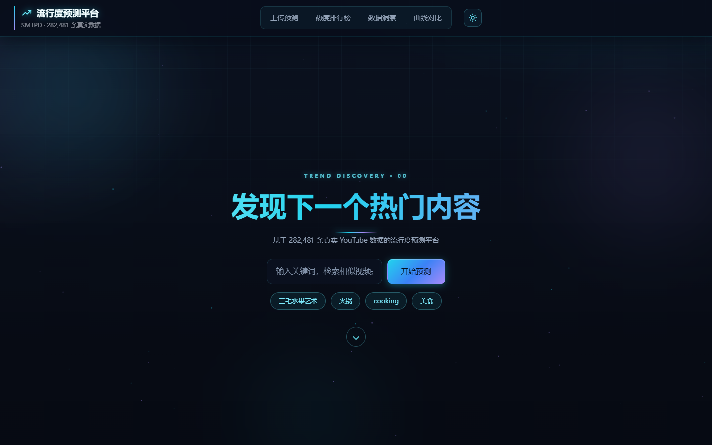
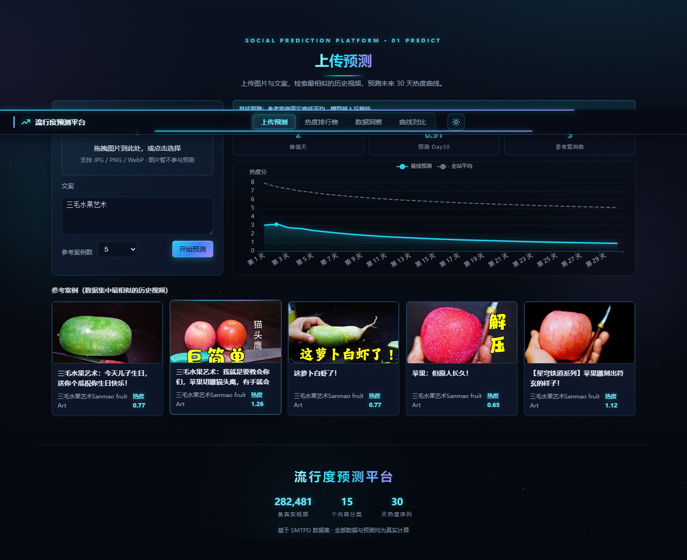
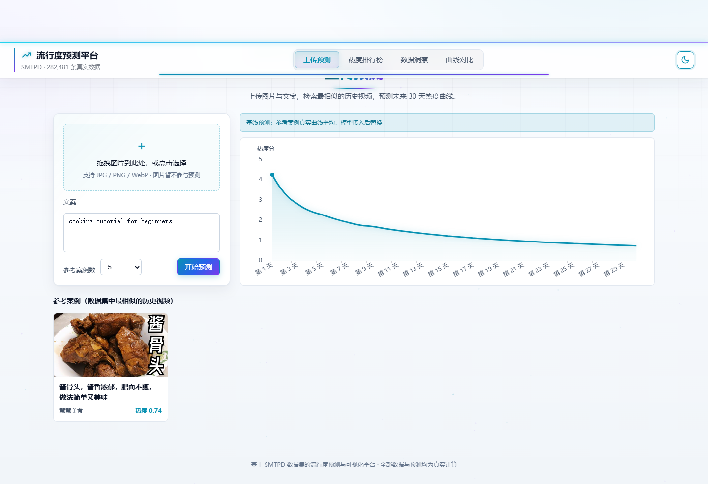
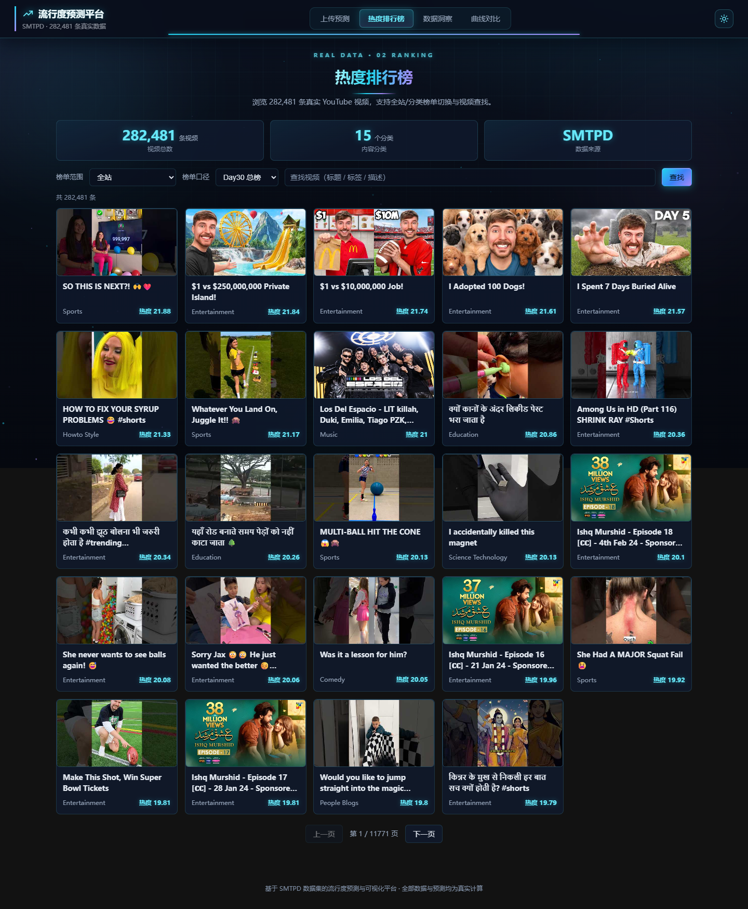
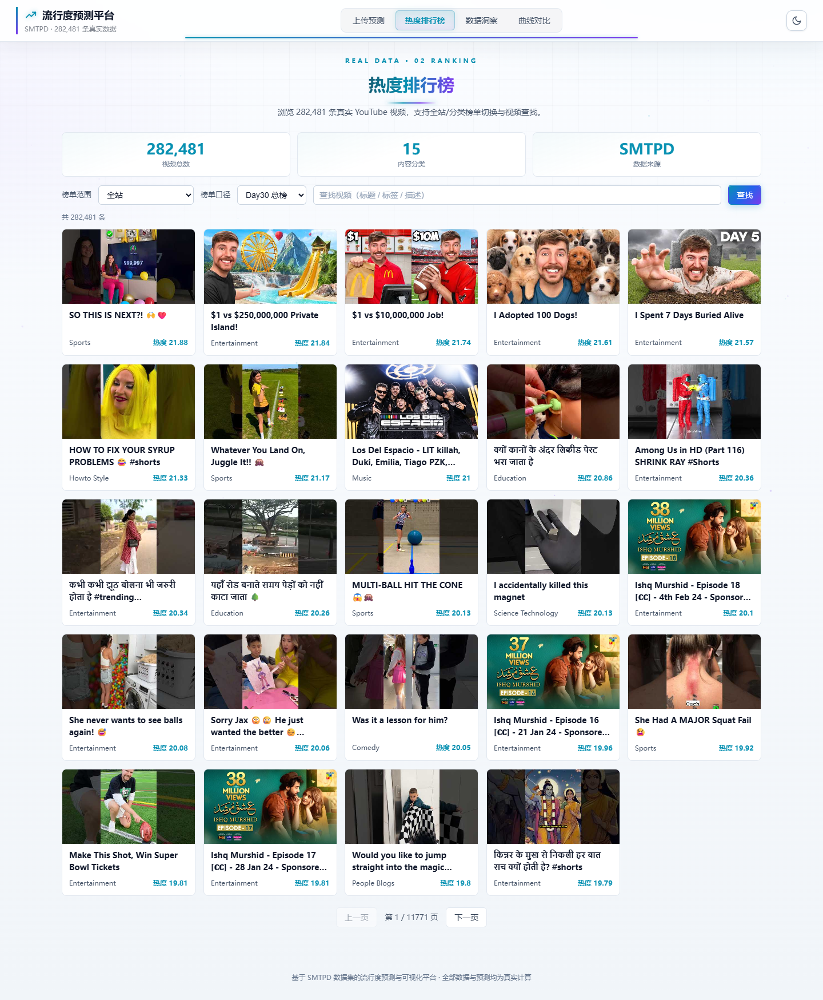
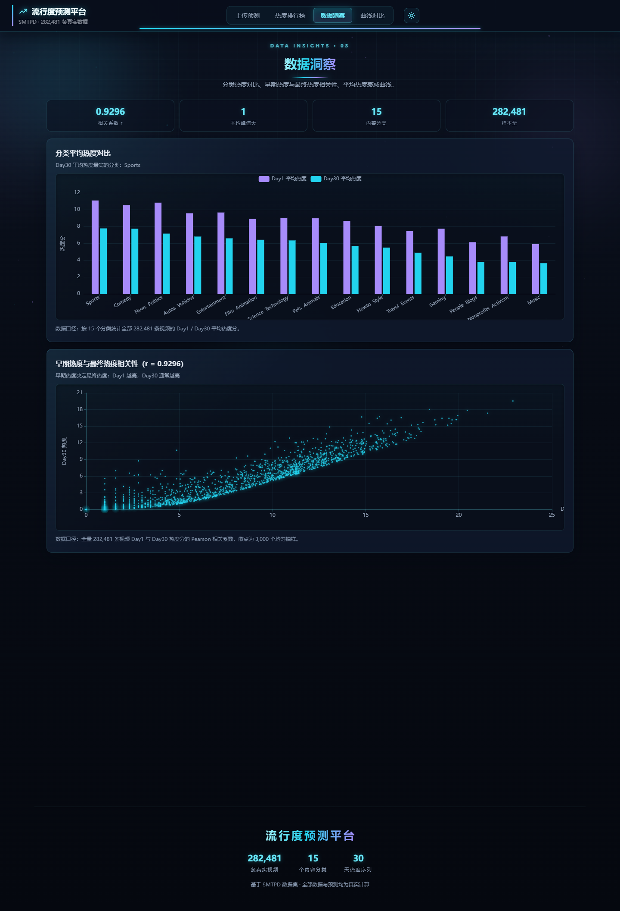
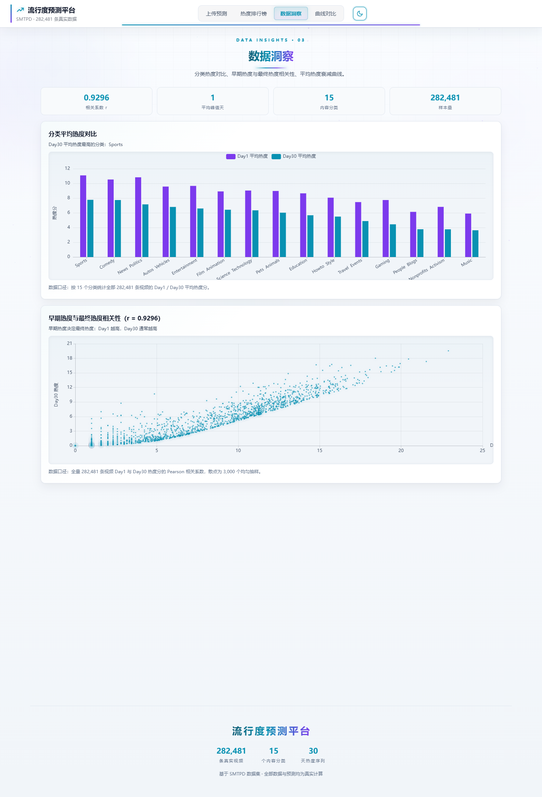
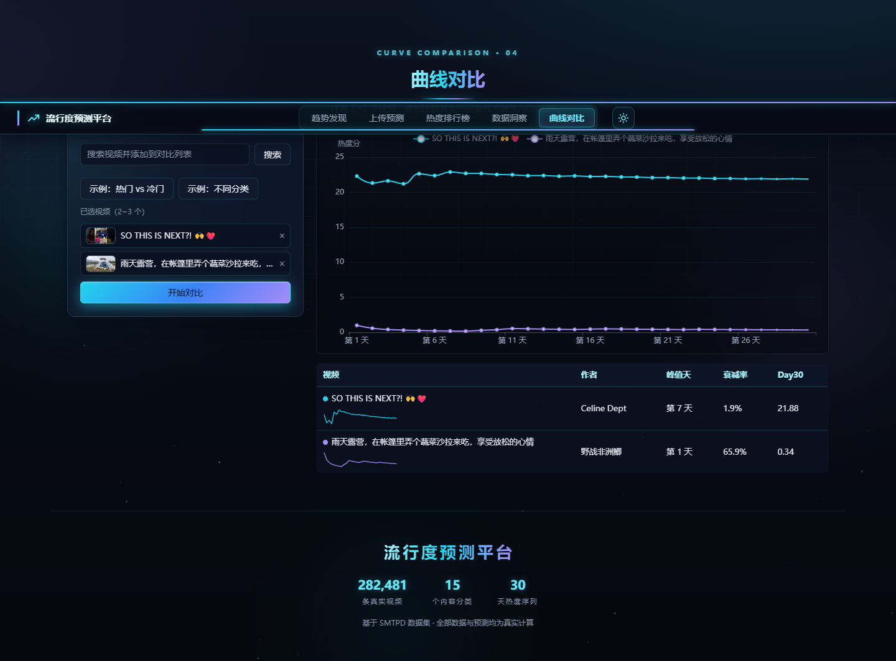
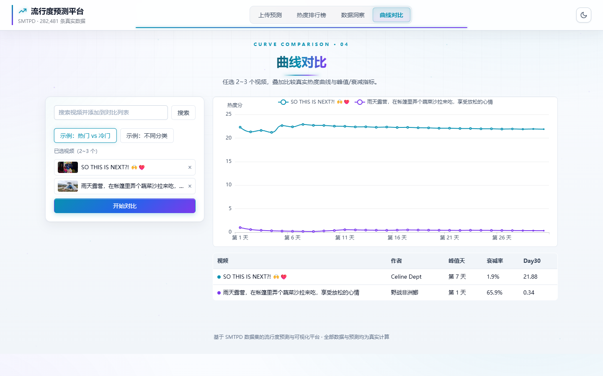

# 多模态社交媒体流行度预测与可视化分析平台

基于 SMTPD 数据集（**282,481 条真实 YouTube 视频**：封面图 + 文本 + 30 天热度序列）构建的流行度预测与可视化分析平台，面向大创项目答辩演示与软件著作权申请。页面中的检索、预测与图表全部基于真实数据计算，不包含任何 mock 数据；预测当前采用基线实现，模型可后接入。

## 功能特性

- **趋势发现首页**：全屏沉浸式落地页（Hero 大标题 + 超大搜索框 + 示例关键词 + 向下引导），第二屏「今日正在爆发的选题」+ 完整榜单入口；独立 URL（`#/`、`#/predict`…）支持刷新保持、浏览器前进后退与分享
- **上传预测**：输入文案，检索最相似的历史视频（BM25 + FTS5 trigram 中文全文检索），以参考案例的真实曲线平均生成未来 30 天热度预测曲线；结果区含 KPI（峰值天 / 预测 Day30 / 参考案例数）与全站平均对照虚线
- **热度排行榜**：浏览 282,481 条真实视频，支持榜单范围（全站 / 15 个分类）× 榜单口径（Day30 总榜 / Day1 新热榜 / 长红榜）切换，标题/标签/描述检索、分页与详情弹窗；视频卡带排名序号、涨跌角标与 KPI 指标行
- **数据洞察**：分类平均热度对比、Day1 与 Day30 热度相关性散点（r = 0.9296，早期热度决定最终热度）、平均热度衰减曲线（整体 / 分类切换），顶部 KPI 行 + 结论先行标题
- **曲线对比**：任选 2~3 个视频叠加真实热度曲线，对比峰值天与衰减率，表格内嵌 30 点迷你趋势线，含预置示例
- **深色 / 浅色双主题**：顶栏图标一键切换，图表实时重绘，选择持久化到 localStorage
- **动效与交互**：预加载动画、背景粒子与极光光斑、滚动进度条、磁吸按钮、卡片 3D 倾斜、图表入场生长动画；滚动期间自动暂停重特效保证流畅

## 截图

| 深色模式 | 浅色模式 |
| --- | --- |
|  |  |
|  |  |
|  |  |
|  |  |
|  |  |

## 技术栈

| 层次 | 选型 |
| --- | --- |
| 后端 | Java 17 + Spring Boot 3.2.5 + Maven + SQLite（sqlite-jdbc） |
| 检索 | SQLite FTS5 trigram 中文全文索引 + BM25 排序，LIKE 兜底 |
| 前端 | 原生 HTML/CSS/JS + ECharts 5.5.1（全部本地化，断网可用） |
| 数据处理 | Python 脚本（CSV → SQLite 索引、封面提取、跨磁盘分卷还原） |
| 测试 | JUnit 5 + MockMvc，24 个用例全部通过 |

## 快速开始

环境要求：JDK 17、Maven 3.9+，数据文件位于 `data/`（见「数据说明」）。

```bash
# 方式一：Windows 下双击 start.bat
# 方式二：
mvn -s mvn-settings.xml spring-boot:run
```

浏览器打开 <http://localhost:8080>

> `mvn-settings.xml` 为本机 Maven 配置（已被 .gitignore 忽略）；标准 Maven 环境可直接使用 `mvn spring-boot:run`。

## 数据说明

| 文件 | 说明 |
| --- | --- |
| `data/basic_view_pn.csv` | SMTPD 原始数据（608MB，282,481 行，35 列） |
| `data/smtpd.db` | SQLite 索引（1.89GB，15 个分类，FTS5 全文索引），由 `scripts/build_index.py` 生成 |
| `data/img_yt.zip` | 封面压缩包（9.25GB，201,408 个条目），由 `scripts/extract_spanning_zip.py` 分卷还原 |
| `data/covers/` | 本地封面（19,732 张轻量方案），缺失时按需从 zip 提取 |

> `data/` 已被 .gitignore 忽略，不会进入 Git 仓库；克隆后需自行准备数据文件。

## 接口一览（统一返回 `{code, message, data}`）

| 接口 | 说明 |
| --- | --- |
| `GET /api/health` | 健康检查 |
| `GET /api/videos` | 分页 / 榜单范围（分类）/ 榜单口径（day30 / day1 / longrun）/ 查找 |
| `GET /api/videos/{id}` | 视频详情 + 30 天曲线 + 峰值天 / 衰减率 |
| `GET /api/insights` | 分类热度、Day1-Day30 相关性、平均衰减曲线（支持 `?refresh=true` 重算） |
| `POST /api/compare` | 2~3 个视频曲线对比 |
| `POST /api/predict` | 上传图文 + 30 天基线预测（multipart） |
| `GET /covers/{前缀}/{id}.jpg` | 封面（缺失按需提取 / 占位图） |

## 预测原理（基线）

- 文案长度 ≥ 3：FTS5 trigram 索引（标题 / 标签 / 描述）按 BM25 相关度取 Top-K 参考案例；
- 文案过短或查询语法异常：LIKE 模糊匹配，按 Day30 热度降序；
- 预测曲线 = 参考案例真实 30 天曲线的逐天平均；无命中时回退全站平均衰减曲线；
- 上传图片当前仅保存，不参与检索与预测（页面已标注）；
- 模型接入：`app.prediction-mode` = `baseline`（默认）/ `remote`（HTTP 调用 Python 服务），切换配置即可，前端与接口契约不变。

## 测试

```bash
mvn -s mvn-settings.xml test
```

## 项目结构

```text
src/main/java/com/prediction/   # Spring Boot 后端（api / data / service / config）
src/main/resources/static/      # 前端五页面（index.html + css / js / lib）
scripts/                        # 数据处理脚本（建索引 / 封面提取 / 分卷还原）
docs/                           # 方案、演示脚本、成果清单、重构报告
data/                           # 数据资产（git 忽略）
```

## 文档索引

- [docs/成果清单.md](docs/成果清单.md)：成果与软著申报素材
- [docs/DEMO.md](docs/DEMO.md)：演示脚本与故障应对
- [docs/PLAN.md](docs/PLAN.md)：完整方案与变更记录

## 数据来源与声明

- 数据集：SMTPD（<https://github.com/zhuwei321/SMTPD>）
- 本仓库仅包含平台代码与文档；原始数据与封面需按上述说明自行准备，请遵守数据集授权与平台内容使用规范。
